# MuOnline Clone

<div align="center">

[](https://dotnet.microsoft.com/download/dotnet/10.0)
[](https://www.monogame.net/)
[](#license)
[](https://github.com/xulek/muonline/actions)
[](https://deepwiki.com/xulek/muonline)

**A cross-platform MuOnline client implementation built with .NET 10 and MonoGame framework.**

[Screenshots](#screenshots) • [Features](#-features) • [Quick Start](#-quick-start) • [Building](#-building-the-project) • [Architecture](#-architecture-overview) • [Contributing](#-contributing)

</div>

---

> **⚠️ Educational Purpose Disclaimer**
> This project is created strictly for **educational and research purposes** to explore game client architecture, network protocols, and cross-platform development with .NET and MonoGame. This is a non-commercial, open-source learning project that demonstrates reverse engineering and game development concepts.

---

## Demo

https://youtu.be/_ekXCQI2byE

---

## Screenshots

<p align="center">
  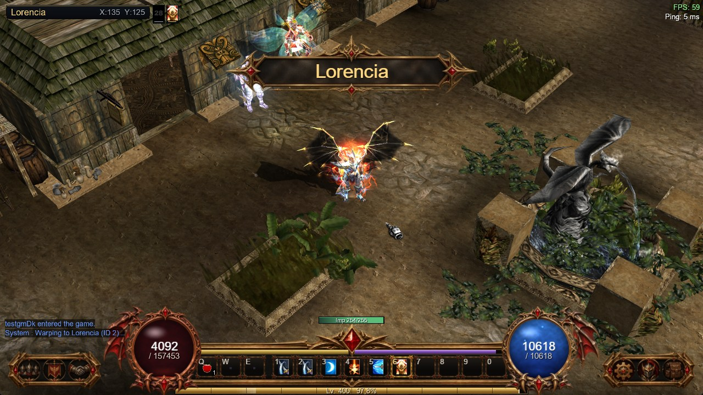
</p>

### World & combat

| | |
|---|---|
| 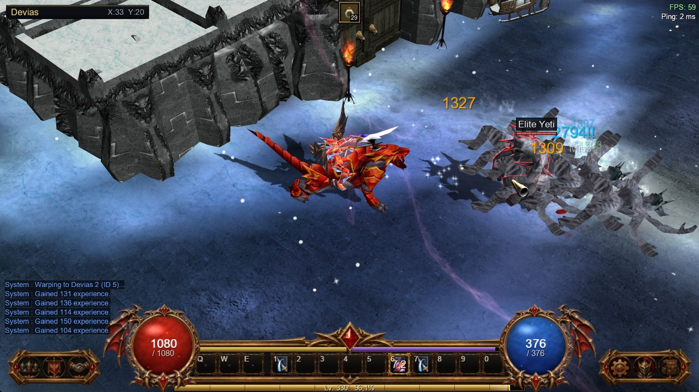 | 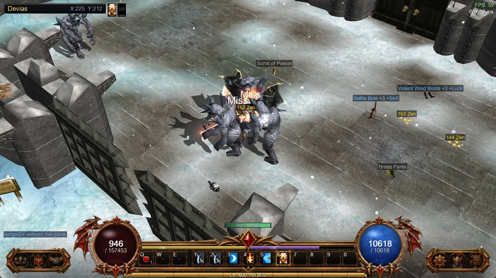 |
| 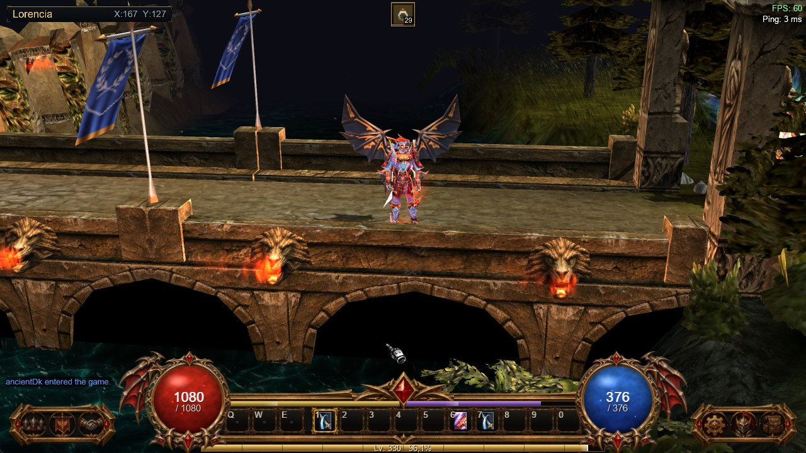 | 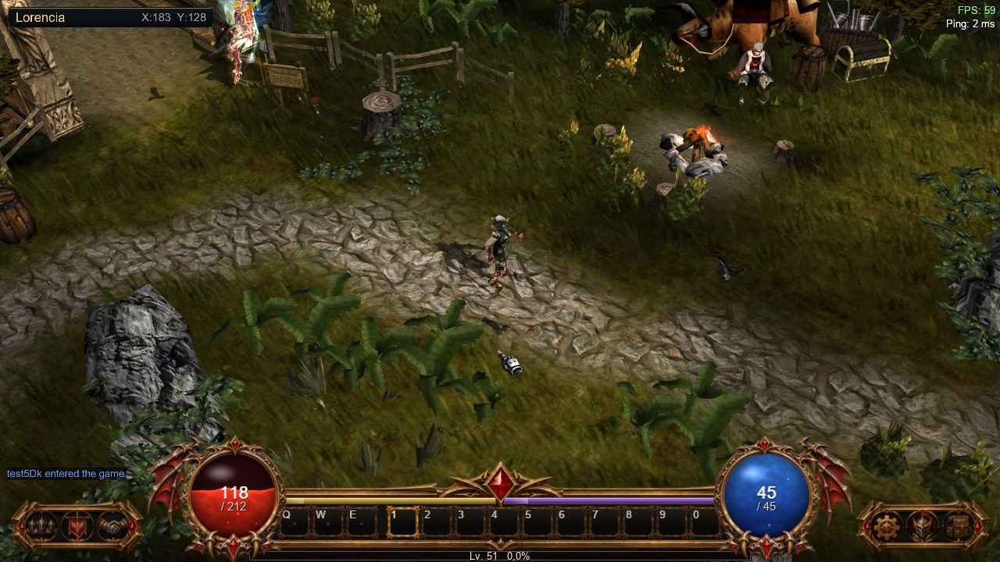 |
| 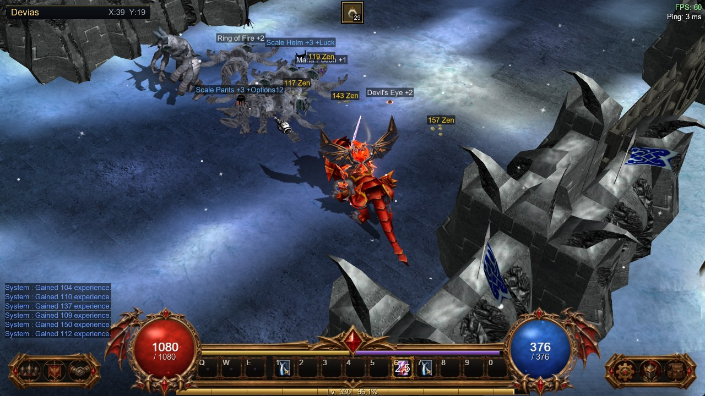 | 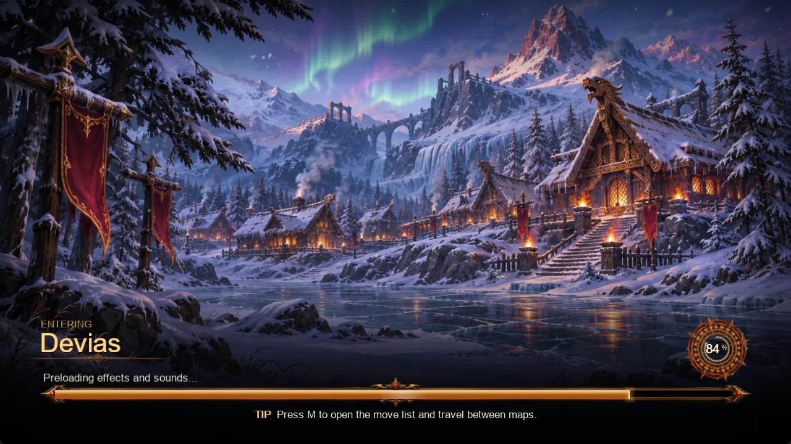 |

### Characters

| | |
|---|---|
| 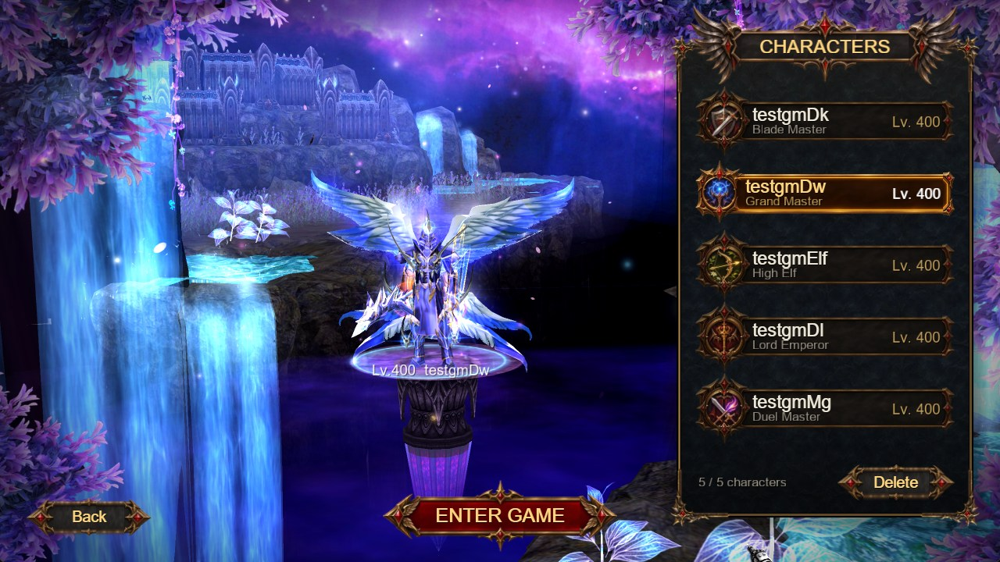 | 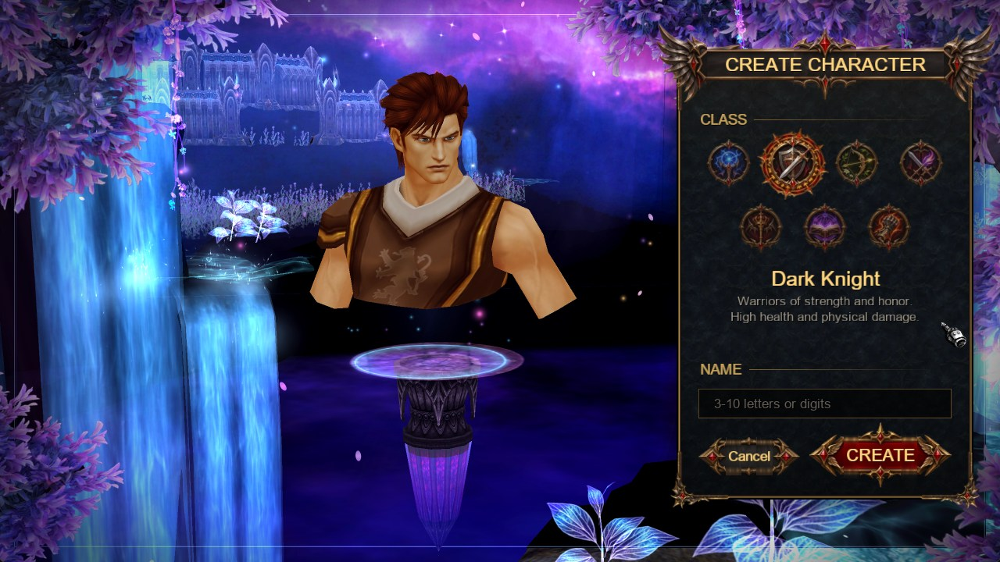 |

<p align="center">
  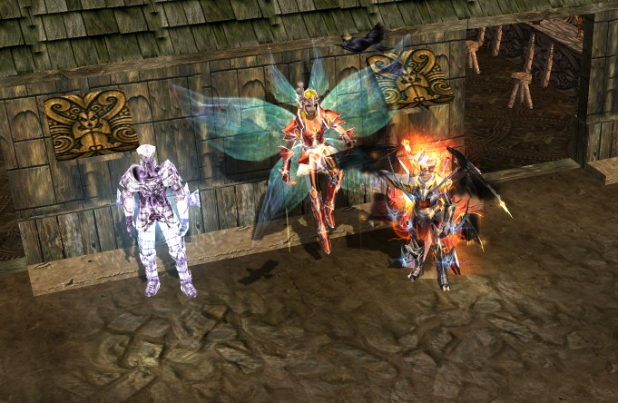
</p>

### User interface

| | |
|---|---|
| 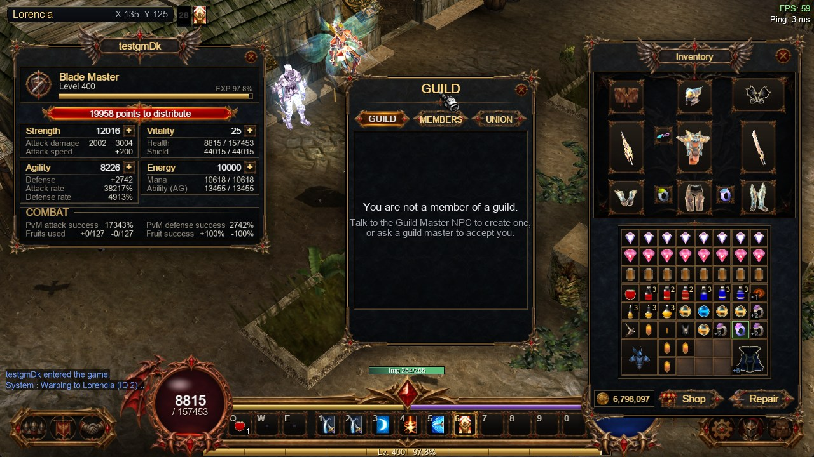 | 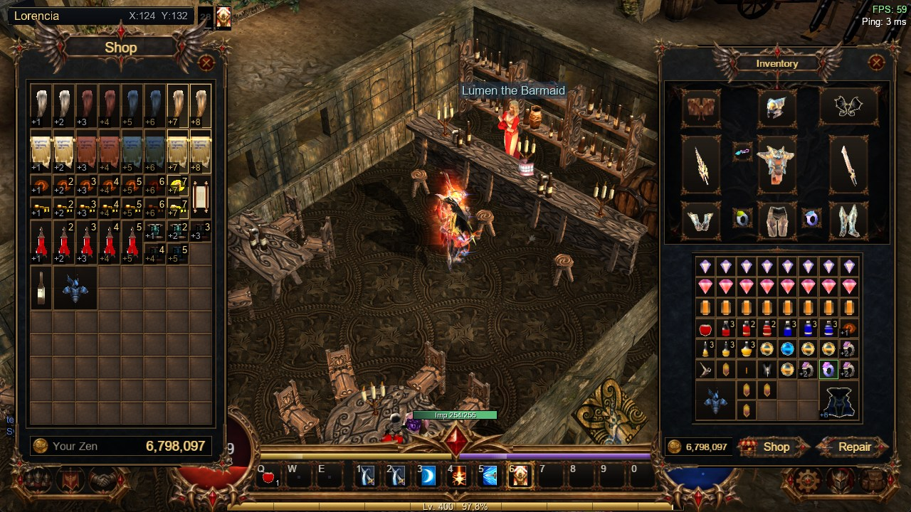 |
| 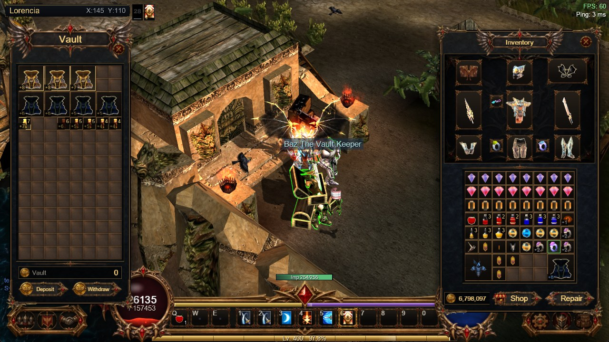 | 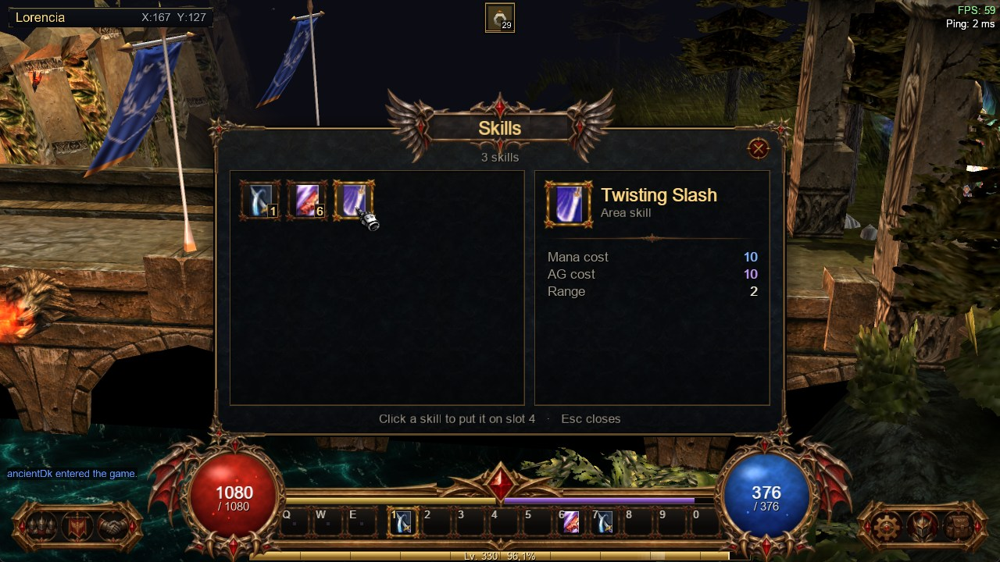 |

<p align="center">
  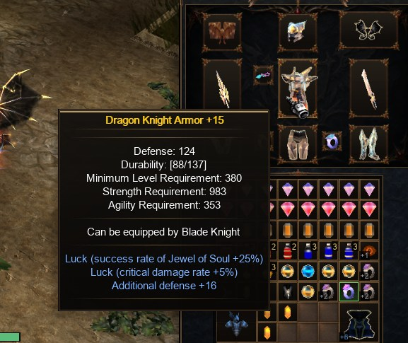
  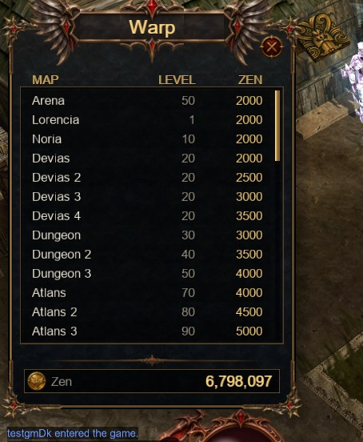
</p>

---

## 🎮 Features

- **🌐 Cross-Platform Support** - Windows, Linux, macOS, Android, and iOS
- **🎨 Full 3D Rendering** - MonoGame-based graphics engine with dynamic lighting, shadows, grass and distance fog
- **🎯 Multiple Graphics Backends** - DirectX 11 (default), OpenGL (compatibility), DirectX 12 and Vulkan (experimental)
- **✨ Faithful Skill Effects** - Skill visuals, timing and animations ported from the original 5.2 client source
- **🧾 Original Item Tooltips** - Item names, options, set/socket/harmony bonuses and prices read from the original text and item tables
- **🏰 Ornate UI** - HUD, inventory, vault, shops, character, skills, guild and warp windows; cinematic login and character selection scenes
- **📦 Original Data Compatibility** - Supports Season 20 (1.20.61) game data files
- **🔌 Network Protocol** - Season 6 (S6) protocol implementation
- **🎯 Multiplayer Ready** - Full networking stack with packet handling system
- **🖼️ Resolution-Independent UI** - Virtual 1280x720 coordinates scaled to any window size; settings in the in-game pause menu
- **🗺️ Terrain Rendering** - Heightmap-based terrain with walkability attributes
- **🏃 Character Animation** - BMD skeletal animation system
- **💡 Real-Time Lighting** - Dynamic lighting with shader support
- **⚡ Performance Optimized** - Multi-threaded packet processing with main thread scheduling

## 📋 Prerequisites

### Required Software

| Component | Version | Download Link |
|-----------|---------|---------------|
| **.NET SDK** | 10.0+ | [Download](https://dotnet.microsoft.com/en-us/download/dotnet/10.0) |
| **Git** | Latest | [Download](https://git-scm.com/downloads) |
| **MuOnline Data** | Season 20 (1.20.61) | [Download](https://full-wkr.mu.webzen.co.kr/muweb/full/MU_Red_1_20_61_Full.zip) |
| **Data S6 Patch** | Season 6 | [Download](https://drive.google.com/file/d/1vP1AfTDl5A22tmIJH5NzyofeFXw_Sut0/view?usp=sharing) |

### Platform-Specific Requirements

<details>
<summary><b>⊞ Windows</b></summary>

- Windows 10/11 (64-bit)
- Visual Studio 2022 (optional, for IDE support)

**Graphics Backend Options:**
- **OpenGL (MuWinGL)** - Better hardware compatibility, works on older GPUs
- **DirectX 11 (MuWinDX)** - Better performance on modern hardware, Windows-only

**Recommended:** Try DirectX first for best performance. Use OpenGL if you encounter graphics issues or have older hardware.
</details>

<details>
<summary><b>🐧 Linux</b></summary>

- Compatible with most x64 distributions
- Required packages: `libgdiplus`, `libopenal-dev`
```bash
# Ubuntu/Debian
sudo apt-get install libgdiplus libopenal-dev

# Fedora
sudo dnf install libgdiplus openal-soft-devel
```
</details>

<details>
<summary><b>🍎 macOS</b></summary>

- macOS 11.0+ (Big Sur or later)
- Xcode Command Line Tools
```bash
xcode-select --install
```
- Optional: `wine` (if you want local MGCB shader/content compilation instead of prebuilt fallback)
</details>

<details>
<summary><b>📱 Android</b></summary>

- Android SDK (API Level 21+)
- Java Development Kit (JDK) 11 or later
</details>

<details>
<summary><b>📱 iOS</b></summary>

- macOS with Xcode installed
- Valid Apple Developer account (for device deployment)
- iOS 10.0+ target
</details>

## 🚀 Quick Start

### 1️⃣ Clone the Repository

```bash
git clone https://github.com/xulek/muonline.git
cd muonline
```

### 2️⃣ Download Game Data

This client requires **Season 20 (1.20.61)** client data files for assets (models, textures, maps) but communicates using **Season 6 protocol**.

1. Download: [MU Red 1.20.61 Full Data](https://full-wkr.mu.webzen.co.kr/muweb/full/MU_Red_1_20_61_Full.zip)
2. Extract the archive to a location on your system
3. Note the path to the `Data` folder

### 3️⃣ Configure Data Path

The client looks for the game data in this order:

1. The `MU_DATA_PATH` environment variable, if set.
2. Debug builds on Windows: `C:\Games\MU_Red_1_20_61_Full\Data` (set in `MuWinDX/Program.cs` and the other Windows heads).
3. Otherwise a `Data` folder next to the executable. When it is missing, the loading screen downloads the 1.20.61 data archive.

```powershell
# Windows (PowerShell)
$env:MU_DATA_PATH = "D:\Games\MU_Red_1_20_61_Full\Data"
```

```bash
# Linux/macOS
export MU_DATA_PATH="$HOME/Games/MU_Red_1_20_61_Full/Data"
```

### 4️⃣ Configure Server Settings

Edit `Client.Main/appsettings.json`:

```json
{
  "MuOnlineSettings": {
    "ConnectServerHost": "localhost",
    "ConnectServerPort": 44405,
    "ProtocolVersion": "Season6",
    "ClientVersion": "1.04d",
    "ClientSerial": "0123456789ABCDEF"
  }
}
```

### 5️⃣ Set Up Server (Recommended: OpenMU)

This client is designed to work with **[OpenMU](https://github.com/MUnique/OpenMU)**, an open-source MuOnline server implementation.

**Quick Start with Docker:**

```bash
# Download and run OpenMU server
curl -o docker-compose.yml https://raw.githubusercontent.com/MUnique/OpenMU/master/deploy/all-in-one/docker-compose.yml
docker-compose up -d
```

The server will be available at `localhost:44405` (matches default client configuration).

**Alternative:** You can also connect to any Season 6 compatible MuOnline server.

### 6️⃣ Restore Tools & Build

```bash
# Restore .NET tools
dotnet tool restore

# Build the solution
dotnet build
```

### 7️⃣ Run the Client

```bash
# Windows (DirectX 11 - Recommended)
dotnet run --project ./MuWinDX/MuWinDX.csproj -f net10.0-windows -c Debug -p:MonoGameFramework=MonoGame.Framework.WindowsDX

# Windows (OpenGL - For compatibility)
dotnet run --project ./MuWinGL/MuWinGL.csproj -f net10.0-windows -c Debug -p:MonoGameFramework=MonoGame.Framework.DesktopGL

# Windows (DirectX 12 / Vulkan - experimental)
dotnet run --project ./MuWinDX12/MuWinDX12.csproj -c Debug
dotnet run --project ./MuDesktopVK/MuDesktopVK.csproj -c Debug

# Linux
dotnet run --project ./MuLinux/MuLinux.csproj -f net10.0 -c Debug

# macOS
dotnet run --project ./MuMac/MuMac.csproj -f net10.0 -c Debug

# macOS (force prebuilt content fallback)
dotnet run --project ./MuMac/MuMac.csproj -f net10.0 -c Debug -p:UsePrebuiltContent=true
```

## 🔨 Building the Project

### Project Structure

```
muonline/
├── Client.Data/           # Data file readers (BMD, ATT, MAP, OZB, etc.)
├── Client.Main/           # Core game engine, networking, UI, game logic
├── Client.Editor/         # Asset editor tool
├── Client.Telemetry/      # Telemetry protocol shared with the diagnostics service
├── MuDiagnostics.Web/     # Optional diagnostics web service
├── MuWinDX/               # Windows DirectX 11 executable (MonoGame.Framework.WindowsDX)
├── MuWinGL/               # Windows OpenGL executable (MonoGame.Framework.DesktopGL)
├── MuWinDX12/             # Windows DirectX 12 executable (experimental)
├── MuDesktopVK/           # Windows Vulkan executable (experimental)
├── MuAndroid/             # Android executable project
├── MuIos/                 # iOS executable project
├── MuLinux/               # Linux executable project
├── MuMac/                 # macOS executable project
├── tests/                 # Packet, gameplay, tooltip and skill effect check programs
├── scripts/               # Publish scripts (Windows, Android)
└── screenshots/           # README screenshots
```

### Development Builds (per head)

> For predictable restores and to avoid missing workloads, build/clean one head at a time.

```bash
# Windows DirectX (Recommended)
dotnet clean MuWinDX/MuWinDX.csproj && dotnet build MuWinDX/MuWinDX.csproj -c Debug -p:MonoGameFramework=MonoGame.Framework.WindowsDX

# Windows OpenGL
dotnet clean MuWinGL/MuWinGL.csproj && dotnet build MuWinGL/MuWinGL.csproj -c Debug -p:MonoGameFramework=MonoGame.Framework.DesktopGL

# Linux
dotnet clean MuLinux/MuLinux.csproj && dotnet build MuLinux/MuLinux.csproj -c Debug

# macOS
dotnet clean MuMac/MuMac.csproj && dotnet build MuMac/MuMac.csproj -c Debug

# macOS (force prebuilt content fallback)
dotnet clean MuMac/MuMac.csproj && dotnet build MuMac/MuMac.csproj -c Debug -p:UsePrebuiltContent=true

# Android (requires Android workload)
dotnet workload restore
dotnet clean MuAndroid/MuAndroid.csproj && dotnet build MuAndroid/MuAndroid.csproj -c Debug

# iOS (requires macOS + Xcode + iOS workload)
dotnet workload restore
dotnet clean MuIos/MuIos.csproj && dotnet build MuIos/MuIos.csproj -c Debug
```

### Production Builds

Build outputs are placed in `bin/Release/` directories.

#### Windows

For the maximum-performance DirectX build, use the validated publish script:

```powershell
./scripts/publish/windows-performance.ps1
```

The script publishes a self-contained `win-x64` folder build with ReadyToRun, tiered compilation, dynamic PGO, optimized shaders, disabled runtime diagnostics, and a SHA-256 manifest. It also validates the generated runtime configuration before creating the archive.

A diagnostic Release build can be produced without the compile-time performance profile:

```powershell
dotnet publish ./MuWinDX/MuWinDX.csproj -c Release -r win-x64 -p:PerformanceRelease=false
```

OpenGL remains available as the compatibility backend:

```bash
dotnet publish ./MuWinGL/MuWinGL.csproj -c Release -r win-x64 -o publish-gl -p:MonoGameFramework=MonoGame.Framework.DesktopGL
```

The GitHub Actions workflow builds the Windows OpenGL, DirectX 11, DirectX 12 (experimental) and Vulkan (experimental) versions plus an Android ARM64 APK on every push to `main` and publishes them to GitHub Pages.

The performance build runs on whichever GPU Windows assigns to it. On laptops with two GPUs, pick the dedicated one in **Settings → System → Display → Graphics** (add `MuMono.exe`, choose **High performance**).

#### Linux

```bash
dotnet publish ./MuLinux/MuLinux.csproj -f net10.0 -c Release -r linux-x64 --self-contained
```

#### macOS

```bash
dotnet publish ./MuMac/MuMac.csproj -f net10.0 -c Release

# Force prebuilt content fallback during publish
dotnet publish ./MuMac/MuMac.csproj -f net10.0 -c Release -p:UsePrebuiltContent=true
```

### macOS Content Build Modes (Wine vs Prebuilt)

`MuMac.csproj` supports two content workflows:

- **Default (preferred):** uses `Content.mgcb` and builds content normally.
- **Fallback:** uses prebuilt `.xnb` files from:
  - `Client.Main/MGContent/PrebuiltContent/DesktopGL/Content`

How it works:

- On non-Windows, if `wine` is available, build stays in default MGCB mode.
- On non-Windows, if `wine` is not available, build automatically switches to prebuilt mode.
- You can force fallback mode with `-p:UsePrebuiltContent=true`.

To prepare prebuilt content:

1. Build content on a machine/CI where MGCB shader compilation works (typically Windows or macOS with `wine`).
2. Copy generated `DesktopGL` `.xnb` files into:
   - `Client.Main/MGContent/PrebuiltContent/DesktopGL/Content`
3. Keep this folder synchronized with `Client.Main/MGContent/Content.mgcb`.

#### Android

```bash
dotnet publish ./MuAndroid/MuAndroid.csproj -f net10.0-android -c Release \
  -p:AndroidSdkDirectory="<path-to-android-sdk>" \
  -p:JavaSdkDirectory="<path-to-jdk-11>" \
  -p:AcceptAndroidSdkLicenses=True
```

#### iOS

```bash
# Requires macOS with Xcode and valid signing certificates
dotnet publish ./MuIos/MuIos.csproj -f net10.0-ios -c Release
```

## 🏗️ Architecture Overview

### High-Level Design

This project implements a layered architecture with clear separation of concerns:

```
┌─────────────────────────────────────────────────────────┐
│                    Platform Layer                       │
│  (MuWinGL/MuWinDX, MuLinux, MuMac, MuAndroid, MuIos)    │
└─────────────────────────────────────────────────────────┘
                           ↓
┌─────────────────────────────────────────────────────────┐
│                  Client.Main (Core)                     │
│  ┌──────────────┐  ┌──────────────┐  ┌──────────────┐   │
│  │    Scenes    │  │  Networking  │  │   Rendering  │   │
│  │ (Login/Game) │  │   (S6 Proto) │  │  (MonoGame)  │   │
│  └──────────────┘  └──────────────┘  └──────────────┘   │
│  ┌──────────────┐  ┌──────────────┐  ┌──────────────┐   │
│  │ Game Objects │  │  UI System   │  │ World System │   │
│  │(Player/NPC)  │  │ (GameControl)│  │  (Terrain)   │   │
│  └──────────────┘  └──────────────┘  └──────────────┘   │
└─────────────────────────────────────────────────────────┘
                           ↓
┌─────────────────────────────────────────────────────────┐
│              Client.Data (Data Readers)                 │
│      BMD • ATT • MAP • OZB • OZG • CWS • OBJS           │
└─────────────────────────────────────────────────────────┘
```

### Key Systems

#### 🎬 Scene Management
- **Pattern:** Finite State Machine
- **Implementation:** `BaseScene` base class with `LoginScene`, `LoadScene`, `GameScene`
- **World Switching:** Dynamic world loading via `ChangeWorldAsync<T>()`

#### 🌐 Networking
- **Architecture:** Service-Oriented with attribute-based routing
- **Protocol:** Season 6 (C1/C3 packet structure)
- **Components:**
  - `PacketRouter` - Dual-mode routing (ConnectServer/GameServer)
  - `[PacketHandler]` - Attribute-based handler registration
  - Service Layer - `LoginService`, `CharacterService`, `ConnectServerService`
- **Thread Safety:** Async packet processing with main thread scheduling

#### 🎮 Game Objects
- **Hierarchy:** `WorldObject` → `PlayerObject`, `MonsterObject`, `NPCObject`, `DroppedItemObject`
- **Management:** `ScopeManager` handles object visibility and lifecycle
- **Animation:** BMD skeletal animation system

#### 🖼️ UI System
- **Pattern:** Hierarchical component model
- **Base Class:** `GameControl` with lifecycle methods
- **Scaling:** Virtual resolution (1280x720) with `UiScaler`
- **Events:** Click, Focus, Blur, SizeChanged

#### ⚡ Threading Model
- **Main Thread:** MonoGame rendering and UI updates
- **Network Thread:** Async packet processing
- **Marshalling:** `MuGame.ScheduleOnMainThread(Action)` for thread safety
- **Task Scheduler:** Priority-based queue with backpressure control

## 📁 File Format Support

| Format | Description | Usage |
|--------|-------------|-------|
| **BMD** | 3D models and skeletal animations | Characters, monsters, items, NPCs |
| **ATT** | Terrain walkability attributes | Collision detection, pathfinding |
| **MAP** | Terrain heightmap data | 3D terrain rendering |
| **OZB/OZG** | Compressed texture formats | Textures for models and UI |
| **CWS** | Camera walk/pan scripts | Cinematic camera movements |
| **OBJS** | Object placement data | Map decorations and static objects |

## 🔧 Configuration

### In-game settings

Most options (graphics quality preset, render scale, grass, shadows, weapon trails, inventory camera zoom, music and sound) are changed in the **pause menu → Settings** and saved between sessions.

### Constants.cs (Client.Main/Constants.cs)

Defaults used before saved settings are applied:

- `SHOW_DEBUG_PANEL: false` - Debug panel with FPS, position and network stats
- `UNLIMITED_FPS: false` - VSync on by default
- `RENDER_SCALE: 1.0` - Supersampling multiplier
- `ENABLE_DYNAMIC_LIGHTING_SHADER: true` - GPU-based lighting
- `MSAA_ENABLED: false` - Multi-sample anti-aliasing (performance impact)
- `INVENTORY_CAMERA_SHOWCASE: false` - Camera zoom on the hero while the inventory is open
- `DataPath` - See step 3 of [Quick Start](#-quick-start)

### appsettings.json (Client.Main/appsettings.json)

```json
{
  "Logging": {
    "LogLevel": {
      "Default": "Information",
      "Client.Main.Networking": "Trace"
    }
  },
  "MuOnlineSettings": {
    "ConnectServerHost": "localhost",
    "ConnectServerPort": 44405,
    "ProtocolVersion": "Season6",
    "ClientVersion": "1.04d",
    "ClientSerial": "0123456789ABCDEF",
    "Graphics": {
      "Width": 1280,
      "Height": 720,
      "IsFullScreen": false,
      "UiVirtualWidth": 1280,
      "UiVirtualHeight": 720
    }
  }
}
```

## 🎨 Graphics Backend Comparison

### Windows: OpenGL vs DirectX 11

| Feature | OpenGL (MuWinGL) | DirectX 11 (MuWinDX) |
|---------|------------------|----------------------|
| **Performance** | Good | Excellent (modern GPUs) |
| **Compatibility** | Excellent (older hardware) | Windows 10/11 only |
| **Shader Model** | 3.0 (vs_3_0/ps_3_0) | 4.0 (vs_4_0/ps_4_0) |
| **Visual Quality** | Identical | Identical |
| **Cross-Platform** | Yes (same as Linux/macOS) | Windows-only |
| **Stability** | Very stable | Stable (fixed GPU sync issues) |

### When to Use OpenGL (MuWinGL)
- ✅ Older GPUs or integrated graphics
- ✅ Need exact same rendering as Linux/macOS
- ✅ Experiencing graphics driver issues with DirectX
- ✅ Better compatibility with virtualization/remote desktop

### When to Use DirectX (MuWinDX)
- ✅ Modern dedicated GPU (NVIDIA/AMD)
- ✅ Want best performance on Windows
- ✅ Latest graphics drivers installed
- ✅ Windows 10/11 with DirectX 11 support

### Technical Notes

Both versions produce **identical visual results** but use different rendering paths:

**Shader Compatibility:**
- All shaders use conditional compilation (`#if OPENGL`) to support both backends
- DirectX version includes fixes for GPU buffer synchronization
- Explicit vertex declarations ensure correct memory layout

**Known Fixed Issues (DirectX):**
- ✅ GPU/CPU race conditions in buffer pooling (now disabled for DirectX)
- ✅ Vertex stride mismatches between C# and HLSL shaders
- ✅ Async model loading deadlocks in UI rendering
- ✅ Shadow rendering artifacts

## 🐛 Troubleshooting

<details>
<summary><b>❌ "Data path not found" error</b></summary>

**Solution:** Point the client at your MU data folder with the `MU_DATA_PATH` environment variable, or put the `Data` folder next to the executable.

```powershell
$env:MU_DATA_PATH = "C:\Games\MU_Red_1_20_61_Full\Data"
```

Verify the path exists and contains files like `Data/Player.bmd`, `Data/Item`, etc.
</details>

<details>
<summary><b>❌ Cannot connect to server</b></summary>

**Solution:** Check the following:
1. Server is running (for OpenMU: `docker ps` should show running containers)
2. `appsettings.json` has correct host/port
3. Firewall isn't blocking port 44405
4. Protocol version matches server (Season6)
</details>

<details>
<summary><b>❌ Black screen / Graphics not loading</b></summary>

**Solution:**
1. Verify data files are complete (re-extract if needed)
2. Lower the quality preset in the pause menu settings
3. Update graphics drivers
4. On a laptop with two GPUs, make sure the dedicated GPU is used (Windows graphics settings)
5. **If using DirectX:** Try the OpenGL version (MuWinGL) instead
</details>

<details>
<summary><b>❌ DirectX: Graphics glitches, objects flickering or "exploding"</b></summary>

**Solution:**
These issues have been fixed in the latest version. If you still experience them:

1. **Update to latest version** from GitHub
2. **Clean build:**
   ```bash
   dotnet clean ./MuWinDX/MuWinDX.csproj
   dotnet build ./MuWinDX/MuWinDX.csproj -p:MonoGameFramework=MonoGame.Framework.WindowsDX
   ```
3. **Try OpenGL version** as fallback:
   ```bash
   dotnet run --project ./MuWinGL/MuWinGL.csproj -f net10.0-windows -c Debug -p:MonoGameFramework=MonoGame.Framework.DesktopGL
   ```

**What was fixed:**
- GPU/CPU race conditions in dynamic buffer pooling
- Vertex declaration mismatches in custom shaders
- Async loading deadlocks in inventory rendering
</details>

<details>
<summary><b>❌ DirectX: Client freezes when opening inventory</b></summary>

**Solution:**
Fixed in latest version. The issue was caused by async model loading blocking the main thread.

If still experiencing freezes:
1. Update to latest code
2. Verify you're using the fixed `BmdPreviewRenderer.cs` (checks `modelTask.IsCompleted`)
3. Switch to OpenGL version temporarily
</details>

<details>
<summary><b>❌ Linux: "libopenal.so not found"</b></summary>

**Solution:**
```bash
# Ubuntu/Debian
sudo apt-get install libopenal-dev libgdiplus

# Fedora
sudo dnf install openal-soft-devel libgdiplus
```
</details>

<details>
<summary><b>❌ macOS: MGCB fails with "Wine is not installed"</b></summary>

**Solution options:**

1. Install `wine` and build normally:
   ```bash
   dotnet build ./MuMac/MuMac.csproj -c Debug
   ```
2. Use prebuilt fallback mode:
   ```bash
   dotnet build ./MuMac/MuMac.csproj -c Debug -p:UsePrebuiltContent=true
   ```

If using fallback mode, ensure `.xnb` files exist in:

- `Client.Main/MGContent/PrebuiltContent/DesktopGL/Content`
</details>

<details>
<summary><b>❌ Build errors on mobile platforms</b></summary>

**Solution:** For desktop development, disable mobile targets:
```bash
dotnet build /p:EnableMobileTargets=false
```
</details>

## 🤝 Contributing

Contributions are welcome! This is an educational project, and we encourage learning and experimentation.

### Guidelines

1. **Fork** the repository
2. **Create** a feature branch (`git checkout -b feature/amazing-feature`)
3. **Commit** your changes (`git commit -m 'Add amazing feature'`)
4. **Push** to the branch (`git push origin feature/amazing-feature`)
5. **Open** a Pull Request

### Code Style

- Follow existing code patterns and architecture
- Use `async/await` for networking operations
- Marshal UI updates to main thread via `MuGame.ScheduleOnMainThread()`
- Add XML documentation for public APIs
- Follow [C# Coding Conventions](https://docs.microsoft.com/en-us/dotnet/csharp/fundamentals/coding-style/coding-conventions)

### Reporting Issues

Found a bug or have a question? [Open an issue](https://github.com/xulek/muonline/issues) on GitHub.

## 📚 Additional Resources

- **AGENTS.md** - Notes for contributors and coding agents (code graph tools)
- **scripts/README.md** - Publish scripts
- **OpenMU Server** - https://github.com/MUnique/OpenMU
- **MonoGame Documentation** - https://docs.monogame.net/
- **.NET 10.0 Docs** - https://docs.microsoft.com/en-us/dotnet/

## 📄 License

This project is created for **educational and research purposes only**.

### Important Legal Notes

- This is a **non-commercial** educational project demonstrating game client architecture
- The code in this repository is provided as-is for learning purposes
- Authors are not responsible for misuse of this software

**Protocol Implementation:** The Season 6 network protocol implementation is based on publicly available information and reverse engineering for educational purposes.

**Recommended Use Cases:**
- Learning game client architecture
- Studying network protocol design
- Understanding cross-platform .NET development
- Exploring MonoGame framework capabilities
- Research and educational projects

---

<div align="center">

**Made with ❤️ for the game development community**

[⬆ Back to Top](#muonline-clone)

</div>
